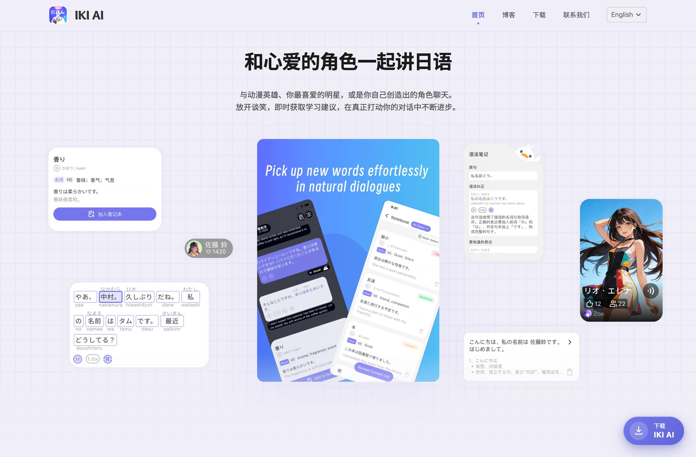

# IKI AI｜AI 日语语音对话与学习产品

[返回主页](../README.md) · [访问产品](https://www.ikiai.org/) · [配套 Content Pipeline](content-pipeline.md)

面向日语学习者提供角色与场景口语练习，覆盖语音对话、语法纠错、语音回复及学习辅助功能。

**我的职责：** 独立全栈研发及部署，覆盖移动端、Web、AI 服务及相关服务端能力。

**技术：** TypeScript、React Native / Expo、Zustand、RxJS、Supabase、LLM API、Embedding、ASR / TTS、Python / FastAPI。

*截图来自产品公开官网，展示日语对话与学习功能。*

## 核心处理流程

1. 接收语音或文字输入，组织场景与近期对话上下文。
2. 按用户与角色召回相关历史记忆，为连续对话提供上下文。
3. 请求 LLM 并流式展示回复，并行处理语法检查等辅助任务。
4. 衔接语音合成与播放，异步完成日志持久化及记忆处理。

## 工程重点

- **交互时序：** 使用 RxJS 编排语音识别、LLM 回复和语音合成，结合取消、订阅清理与分级重试处理交互中断及异步竞态。
- **跨端状态：** 使用 Zustand 组织会话、任务与语音播放状态，通过 selector 和按需订阅控制组件更新范围。
- **检索记忆：** 通过 Embedding 召回相关历史内容，结合当前场景和近期对话构建模型上下文。
- **配套 NLP：** 使用 FastAPI + SudachiPy 实现分词与注音，将请求路径上的 LLM 校验替换为本地规则与缓存，并兼容新旧客户端接口和分词定位。

## 模型评测与回归

基于合成用例的开发集与冻结验证集，对三组模型配置进行了 **600 次真实模型调用**：

| 阶段 | 调用次数 | 用途 |
| --- | --- | --- |
| 开发集评测 | 288 | 比较输出合规性、业务评分、费用与耗时 |
| 定向约束复测 | 24 | 验证日语输出约束漏洞修复 |
| 冻结验证集评测 | 288 | 在独立验证集上检查方案表现 |

定向约束复测 **24/24 通过**，已包含在总计 600 次调用中。三组配置中有两组属于同一模型的不同推理设置；耗时口径为非流式完整响应时间，复测通过率仅代表这组约束用例的结果。

产品入口提供功能介绍与下载入口；此页展示个人职责和工程实践，源码保留在私有仓库。
